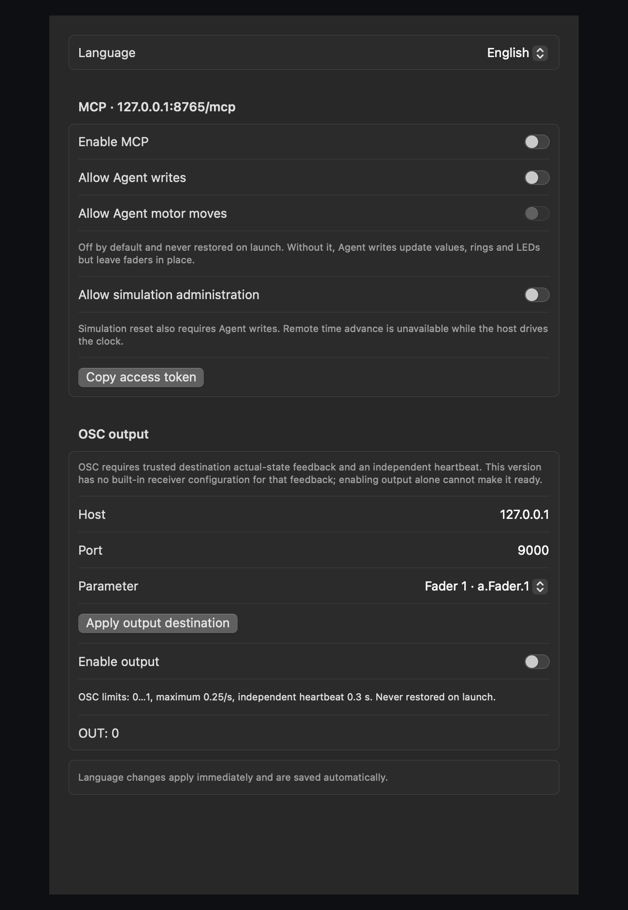
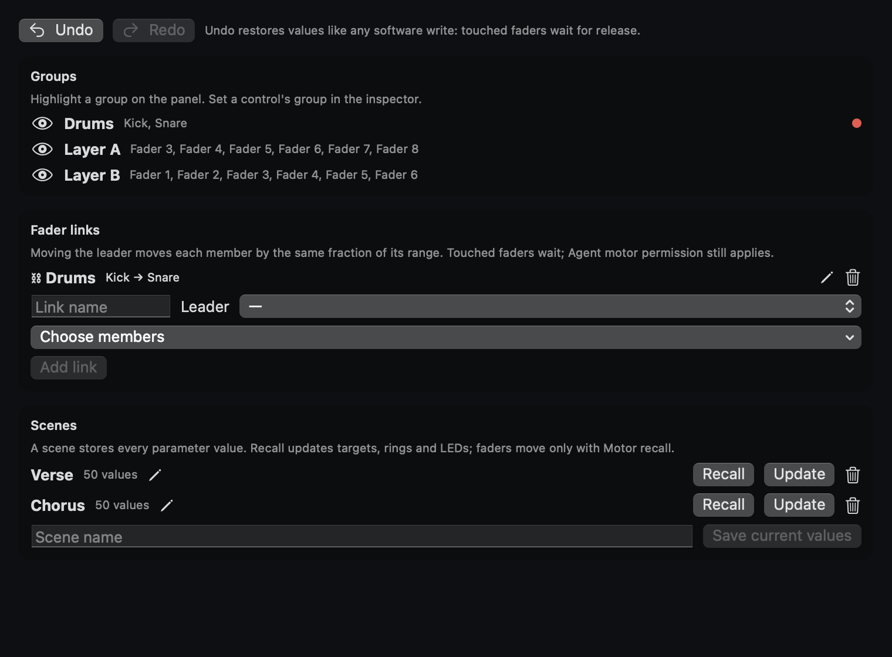
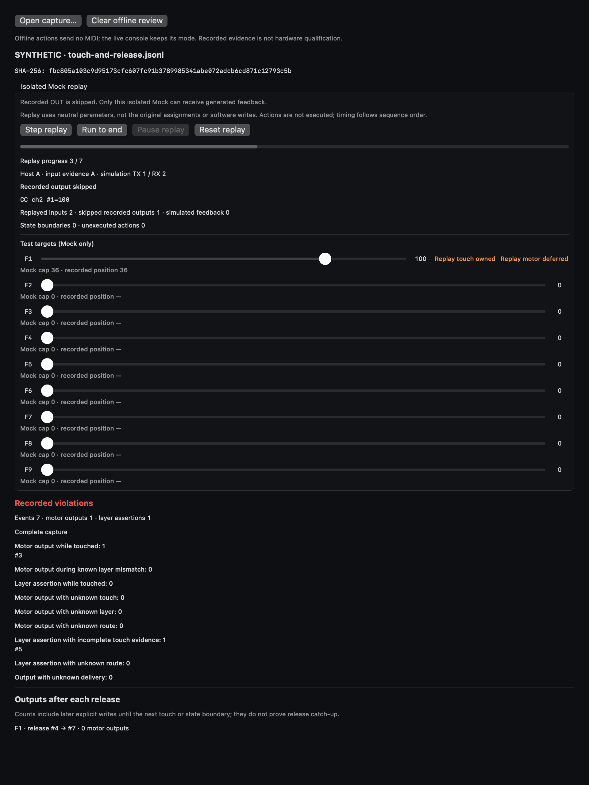

# X-TOUCH COMPACT Console

A native macOS control-surface app for the **Behringer X-TOUCH COMPACT** in its factory
Standard MIDI mode. It turns the controller's motorized faders, encoders and buttons into named
software parameters and actions that you can drive from the hardware, from the on-screen panel, or
from a local AI agent over MCP.


*App-rendered UI with synthetic Mock values. The capture process opens no MIDI ports.*

## Project status (2026-11-13)

| Area | State |
| --- | --- |
| Software in Mock mode | Runs end to end: panel, parameters, organization, agents, MCP, monitor, capture and offline review. Covered by deterministic tests on macOS and Linux. |
| Physical bring-up | **Partial.** Inputs, LEDs, rings, layer selection and a limited set of motor checks were sampled on one unit on 2026-11-12/13. Full control coverage is not signed off. |
| Latest safety changes (U1–U18) | Software-tested only. **Not yet rechecked on hardware (未在实机复核).** |
| Distribution | Build from source. Local packages are ad-hoc signed only; no Developer ID signing or notarization. |

The next attended hardware session starts with **H1** (layer button highlight) and **H6** (touch
gate and silent reconnect). Open work is tracked in [TODO.md](TODO.md); evidence and its limits are
indexed in [experiment records](docs/EXPERIMENT_RECORDS.md).

## Features

- **On-screen panel** laid out like the device: 9 touch-sensitive motorized faders, 16 push
  encoders with LED rings, 39 illuminated buttons, and both A/B layers. The panel shows the last
  received physical value separately from the software target.
- **Parameters** with names, groups, units, ranges and steps. Assign them to faders and encoders,
  and assign toggle, step, set, cycle and group-reset actions to buttons, per layer.
- **Organization.** Rename controls, color-tag and group them, link faders (VCA style), save and
  recall named scenes, and undo value changes. Metadata edits and scene recall send no motor
  command; value changes, linked movement and undo go through the motor safety gates.
- **Touch-aware motor policy.** A touched fader is never commanded. Startup, reconnect and layer
  selection never recall motor positions; recall needs an explicit **Recall motors…**.
- **Mock mode** that models the Standard MIDI input/feedback paths, including the silent firmware
  fader cycle on layer changes, without hardware.
- **Agent slots and optional modules.** Eight demonstration Agent slots (start, wait for approval,
  complete) shown on button LEDs. Reference robot, chassis and parameter-output modules can be
  added with launch flags. All are simulations; no external agent process is launched.
- **Local MCP endpoint** (off by default) for an agent on the same Mac, with legacy tools and the
  shared `surface_` tool set.
- **OSC output** (off by default) behind the shared output gate. It stays closed until a trusted
  actual-state and heartbeat source exists.
- **MIDI monitor, capture and offline review.** Record traffic to JSONL, then audit motor safety
  and replay recorded inputs into an isolated Mock without sending MIDI.
- **Hardware observation.** A/B input coverage review with fingerprinted export, and a locked
  nonmotor test workbench for single LED/ring/layer commands.
- **Software Surface simulator.** A hardware-free executable that exposes the shared control
  contract over authenticated loopback HTTP.
- Interface in **English, Simplified Chinese and Traditional Chinese**.

## Requirements

- macOS 14 or later.
- Swift 6 toolchain (Xcode or the Xcode command-line tools), Python 3.10+ and Git.
- Optional: a Behringer X-TOUCH COMPACT in **factory Standard MIDI mode**, connected over USB.

## Getting started

```sh
git clone https://github.com/NorthBoundWisdom/XTouchCompactDev.git
cd XTouchCompactDev
python3 configs/setup_local_project.py
swift run XTouchCompactApp
```

Setup fetches the shared SurfacePlugins package at the exact commit pinned in
`configs/surface_plugins.lock.json` into `build/dependencies/`. Direct `swift` commands verify that
checkout and refuse a missing, dirty or wrongly pinned one; see
[shared dependency setup](docs/SURFACE_PLUGINS.md).

The app opens in **Mock** mode. Drag the faders, turn the encoders and click the buttons; they
follow the same path as real hardware input.

To build an app bundle and local packages:

```sh
python3 configs/macos_workflow.py build     # build/app/debug/XTouchCompactApp.app
python3 configs/macos_workflow.py package   # Release ZIP and DMG under build/package/
```

### Launch options

| Flag | Effect |
| --- | --- |
| `--hardware-observe` | Open hardware observation with output locked and no saved workspace. Add `--capture-path <file>` to record. |
| `--hardware-control` | Start on hardware with fresh writes allowed. No motor is recalled. |
| `--robot-plugin`, `--chassis-plugin`, `--output-plugin` | Install the optional simulated modules. |
| `--reference-arm-example` | Load the version-2 reference-arm parameter set, with no assignments. |
| `--startup-smoke`, `--integration-test` | Isolated checks: no CoreMIDI, no user workspace, no Keychain. |

## Using the app

| Workspace | What you do there |
| --- | --- |
| Values | See and adjust every control's value on the active layer. |
| Parameters | Define parameters, bulk-assign them, load presets, import and export configurations. |
| Organize | Names, colors, groups, linked faders, scenes, undo and redo. |
| Agents | Start, interrupt and approve Agent slots; view optional module states. |
| MIDI monitor | Watch incoming and outgoing messages; capture to a JSONL file. |
| Offline capture | Import JSONL read-only, review motor safety evidence, and step or run inputs through an isolated Mock. |
| Connection | MIDI ports, TX and Global RX channels, LED encoding, listen-only mode and layer realignment. |

Select any control to open the inspector with its assignment, value, physical reading and MIDI
addresses. **Settings** (⌘,) holds the language, MCP and OSC options. **Hardware observation** in
the header opens the live panel, A/B input review and nonmotor tests.

The configuration and device profile are saved to
`~/Library/Application Support/XTouchCompactConsole/workspace.json`. Parameter values are restored
as software targets only; agent activity resets on restart. Configurations made for other
controllers, including the BCR2000, are rejected on import. Details:
[software workflows](docs/SOFTWARE_WORKFLOWS.md).

### MCP for local agents

1. In Settings, enable MCP. It listens on `127.0.0.1:8765/mcp` only.
2. Copy the access token and give it to your agent as a bearer token.
3. To allow writes, turn on **Allow Agent writes**. Each parameter also has its own agent-write
   permission.
4. Agent writes move motors only with **Allow Agent motor moves** on. It is off by default and never
   restored at launch.

Legacy tools are `get_state`, `set_parameter` and `agent_primary`. The shared `surface_` tools add
discovery, snapshots, actions and cursor-based events; see [shared tools](docs/SHARED_REMOTE.md).
Agent writes use the same touch gate as your own input, and a remote agent cannot approve a waiting
slot.

### OSC output

OSC sends one parameter as a `/xtouch/value` float. The shared gate requires a trusted destination
actual-state sample and an independent heartbeat, each younger than 0.3 seconds. No production
receiver is integrated (TODO D2), so enabling it shows a visible refusal reason. OSC never drives
fader motors. See [OSC behavior](docs/SOFTWARE_WORKFLOWS.md#osc).

## Connecting a real controller

Hardware support is still being verified, so the app is deliberately cautious.

1. Put the controller in **factory Standard MIDI mode** (not MC mode) and connect it by USB. Do not
   flash or modify firmware.
2. Start the app. Each launch begins with **Listen only — send no MIDI** on.
3. Select the input and output ports, then switch from Mock to Hardware.
4. Set **Global RX channel** to what the device actually receives on. The app never infers it from TX
   and never rewrites the saved profile. The measured unit transmits on channel 1 but receives on
   channel 2 and uses the `observed114` LED encoding (0 off, 2 on, 3 blink).
5. Complete the Stage 1 input review in **Hardware observation** before enabling nonmotor tests.
   Motor checks are a separate later stage.
6. Keep all faders untouched before any layer selection, **Sync lights to device** or **Realign
   current layer**. Each sends Program Change, which on the measured unit cycles all nine motors to
   the bottom and back. The app refuses these while any fader is touched.

Connecting, reconnecting and replacing endpoints send no MIDI. The app marks the layer unconfirmed
and lights unsynchronized until you choose **Sync lights to device**. If you unplug the controller
while touching a fader, touch and release that fader once after reconnecting.

The step-by-step checklist is in [hardware bring-up](docs/HARDWARE_BRINGUP.md). To develop against a
controller attached to another Mac, see [remote hardware](docs/REMOTE_HARDWARE.md).

## What is known about the hardware

**Observed on one unit, 2026-11-12/13** ([session record](docs/HARDWARE_SESSION_2026-11-12.md)):

- TX on channel 1, Global RX on channel 2 (measured independently, channel by channel).
- Control 1 of each kind matches the factory TX table on both layers. Encoders report accelerated
  absolute 0–127 and keep sending at the end stops.
- Button LEDs follow 0/2/3 on the sampled buttons; velocity 1 leaves them off.
- A host ring value lights a single LED; a style message redraws the ring and discards it.
- Motor moves send no position report. A command to a held F1 had no effect and was not applied on
  release. F2–F9 moved at one value on layer A; F1 moved on layer B.
- Physical layer keys and Program Change silently cycle all nine motors, which end at one shared
  physical position for both layers.

**Still open** (TODO H1–H7, N5): firmware version, full A/B input and LED/ring coverage, ring
styles under local turning, F2–F9 touch and other motor values, a layer change while touched, the
source of motor travel on USB replug, pedals, startup full-state readback (unverified, not ruled
out), and visual acceptance of the latest UI and safety changes.

**Not supported:** Mackie Control mode, editor-modified presets, firmware replacement, 14-bit fader
resolution, real external agent processes, incoming OSC, Developer ID signing and notarization.

## Software Surface simulator

`XTouchSurfaceSimulator` reuses the Mock interaction engine and exposes the shared control profile,
input and feedback contract over authenticated loopback HTTP. It never opens MIDI, loads user
profiles or starts the GUI, and it qualifies no physical hardware.

```sh
swift build --jobs 2 --product XTouchSurfaceSimulator
python3 configs/package_surface_simulator.py   # self-contained delivery under build/deliveries/
```

The delivery includes the Python SDK, a conformance checker and examples. See
[simulator delivery](docs/SURFACE_SIMULATOR.md) and [Clients/Python](Clients/Python/README.md).

## Repository layout

| Path | Contents |
| --- | --- |
| `Sources/XTouchCompactCore` | Protocol, session, parameters, safety policy and Mock device. No CoreMIDI or SwiftUI; builds on Linux. |
| `Sources/XTouchCompactApp` | Native SwiftUI/CoreMIDI app (`#if os(macOS)`). |
| `Sources/XTouchCompactLocalization` | English, Simplified and Traditional Chinese strings. |
| `Sources/XTouchRemoteMIDI`, `CompactRemoteMIDI` | Command-line listener and guarded single-message sender used in bring-up. |
| `Sources/XTouchSurfaceSimulator`, `CompactSimulatorTransport` | Hardware-free simulator and its HTTP transport. |
| `Clients/Python`, `examples/` | Simulator client SDK and examples. |
| `configs/` | Setup, build, packaging, dependency lock and FreeCM command definitions. |
| `tools/` | Capture motor-safety audit, MCP integration, remote hardware and screenshot helpers. |

## Development

```sh
python3 configs/setup_local_project.py
python3 configs/format_repo.py --check
python3 configs/validate_repo_commands.py .
python3 -m unittest discover -s Tests/BuildWorkflowTests -v
swift test --jobs 2
swift build
```

Tests never need a controller: they inject fake MIDI, temporary storage and in-memory tokens. CI
runs the Linux core on `swift:6.2-noble` and native build, tests, ad-hoc packaging and isolated
startup smoke on Apple Silicon macOS. Contribution rules and hardware safety constraints are in
[AGENTS.md](AGENTS.md) and [CONTRIBUTING.md](CONTRIBUTING.md); build commands and local settings are
in [build workflow](docs/FREECM.md).

## Documentation

| Document | Contents |
| --- | --- |
| [TODO](TODO.md) | Open hardware acceptance, visual checks and product decisions |
| [Experiment records](docs/EXPERIMENT_RECORDS.md) | Index of hardware evidence, build diagnostics and verification runs |
| [Hardware bring-up](docs/HARDWARE_BRINGUP.md) | Staged checklist for a physical controller |
| [Hardware session 2026-11-12](docs/HARDWARE_SESSION_2026-11-12.md) | Input, LED/ring/layer and motor observations, with limits |
| [Hardware session 2026-11-11](docs/HARDWARE_SESSION_2026-11-11.md) | Observation UI acceptance |
| [Ring calibration](docs/RING_CALIBRATION_2026-11-12.md) | Operator ring-appearance samples |
| [Startup readback](docs/STARTUP_READBACK_INVESTIGATION.md) | Investigation of full-state readback at startup |
| [Capture motor audit](docs/CAPTURE_MOTOR_AUDIT.md) | Read-only motor safety audit of recordings |
| [Native acceptance](docs/NATIVE_ACCEPTANCE.md) | N5 mouse acceptance record |
| [Software workflows](docs/SOFTWARE_WORKFLOWS.md) | Parameters, persistence, agents, MCP, OSC, capture and safety policies |
| [MIDI protocol](docs/MIDI_PROTOCOL.md) | Factory Standard MIDI map; documented versus observed behavior |
| [Shared plugins](docs/SURFACE_PLUGINS.md) · [shared tools](docs/SHARED_REMOTE.md) | SurfacePlugins lock and MCP `surface_` tools |
| [Surface simulator](docs/SURFACE_SIMULATOR.md) | Simulator build, delivery and schema |
| [Remote hardware](docs/REMOTE_HARDWARE.md) | Controller on another Mac over SSH (development only) |
| [Build workflow](docs/FREECM.md) | Build, run, test and package commands |
| [Upstream research](docs/UPSTREAM.md) | Related projects and their licenses |

<details>
<summary>More screenshots</summary>

Settings:



Groups, linked faders and named scenes, using synthetic Mock values:



Offline review and isolated replay of a synthetic recording. The example intentionally contains a
violation; recorded output is skipped, and test targets affect only the Mock:



</details>

Capture method and regeneration: [screenshot notes](docs/images/README.md).

## Acknowledgements

Protocol facts and hardware observations draw on
[jetsonhacks/xtouch-compact](https://github.com/jetsonhacks/xtouch-compact) (MIT), reimplemented
independently in Swift. The app's architecture follows its sibling project,
[BCR2000Dev](https://github.com/NorthBoundWisdom/BCR2000Dev).

Behringer and X-TOUCH are trademarks of their respective owner. This project is not affiliated with
or endorsed by Behringer.

## License

[MIT](LICENSE)
