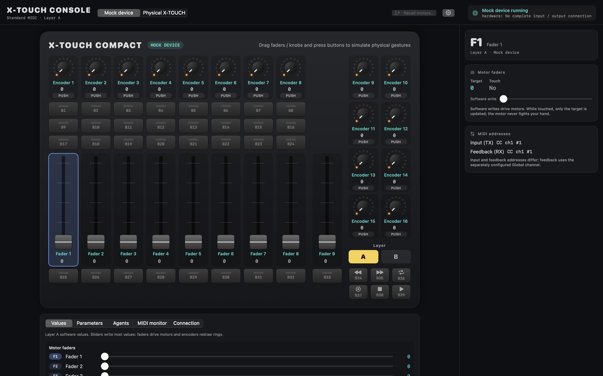

# X-TOUCH COMPACT Console

A native macOS control surface app for the **Behringer X-TOUCH COMPACT**. It turns the controller's
motorized faders, encoders and buttons into named software parameters and actions that you can drive
from the hardware, from the on-screen panel, or from a local AI agent over MCP.



> **Project status: early.** The software runs end to end against a built-in mock device.
> Testing on a physical controller has started but is not complete, so treat hardware output with
> care and read [Connecting a real controller](#connecting-a-real-controller) first.

## What it does

- **On-screen panel** laid out like the device: 9 touch-sensitive motorized faders, 16 push encoders
  with LED rings, 39 illuminated buttons, and both A/B layers.
- **Parameters** with names, groups, units, ranges and steps. Assign them to faders and encoders, and
  assign toggle, step, set, cycle and group-reset actions to buttons. Each layer has its own assignments.
- **Organization.** Rename faders and encoders in place, color-tag and group them, link faders
  (VCA style), save and recall named scenes, and undo value changes. Metadata edits and scene recall
  send no motor CC; value changes, linked movement and undo use the motor safety gates.
- **Touch-aware motor policy.** Reported touch ownership blocks motor commands to that fader.
  No bank-target motor recall happens on connection or layer selection. On the measured unit,
  physical layer keys and host Program Change nevertheless cycle all nine motors to the bottom
  and back, without position TX. Hardware layer/sync commands refuse while any fader is touched.
- **Mock mode** that models the documented Standard MIDI input and feedback paths without hardware.
- **Agent slots.** Eight demonstration slots that start, wait for approval and complete, with status
  shown on button LEDs. These are simulated; no external agent process is launched.
- **Local MCP endpoint** (off by default) so an agent on the same Mac can read state and write
  permitted parameters.
- **OSC output safety** (off by default) for one parameter, using shared limits and a 0.3-second
  heartbeat. It stays closed until a trusted actual-state/heartbeat source is integrated.
- **MIDI monitor and capture** for inspecting traffic and saving it to a file.
- **Hardware observation and nonmotor tests.** Inspect A/B input coverage, export fingerprinted
  evidence, and prepare single LED/ring/layer tests. Output starts locked and requires recorded
  operator prerequisites, independent RX confirmation and an exact command preview.
- **English, Simplified Chinese and Traditional Chinese** interface.

## Requirements

- macOS 14 or later.
- Swift 6 toolchain (Xcode or the Xcode command-line tools) to build from source.
- Optional: a Behringer X-TOUCH COMPACT in its **factory Standard MIDI mode**, connected over USB.

There are no prebuilt, notarized downloads yet. You build the app yourself.

## Getting started

```sh
git clone https://github.com/NorthBoundWisdom/XTouchCompactDev.git
cd XTouchCompactDev
python3 configs/setup_local_project.py
swift run XTouchCompactApp
```

Setup acquires the exact shared Git commit recorded in the repository lock. Until
that commit is published, use a local Git acquisition source as described in
[shared dependency setup](docs/SURFACE_PLUGINS.md).

The app opens in **Mock** mode. Drag the faders, turn the encoders and click the buttons on the panel;
they follow the same path as real hardware input.

To build a double-clickable app bundle instead:

```sh
python3 configs/setup_local_project.py
python3 configs/macos_workflow.py build     # build/app/debug/XTouchCompactApp.app
python3 configs/macos_workflow.py package   # Release ZIP and DMG under build/package/
```

These bundles are ad-hoc signed for local use. They are not signed with a Developer ID or notarized.

## Using the app

| Workspace | What you do there |
| --- | --- |
| Values | See and adjust the current value of every control on the active layer. |
| Parameters | Define parameters, bulk-assign them to controls, load presets, import and export configurations. |
| Agents | Start, interrupt and approve the eight demonstration agent slots; view explicitly enabled optional module states. |
| MIDI monitor | Watch incoming and outgoing messages; start and stop capture to a JSONL file. |
| Offline capture | Import JSONL read-only, review motor safety/unknown evidence, and step or run inputs through an isolated Mock without sending MIDI. |
| Connection | Select MIDI ports and channels and explicitly realign the layer. Source choice and motor recall are in the header. |

Select any control on the panel to open the inspector, which shows its assignment, value and MIDI addresses.

**Settings** (gear button or ⌘,) holds the interface language, the MCP endpoint and OSC output.

Your configuration and device settings are saved to
`~/Library/Application Support/XTouchCompactConsole/workspace.json`. Parameter values and agent activity
are handled separately: parameter values are restored as software targets; agent activity resets on restart.
Configurations made for other controllers, including the BCR2000, are rejected on import.

Full details are in [Software workflows](docs/SOFTWARE_WORKFLOWS.md).

**Hardware observation** in the header opens the live panel, A/B coverage review and nonmotor test
tabs. Nonmotor test settings are session-only, never rewrite the device profile, and do not enable
motor tests. A successful send and an operator's reported response are recorded separately.

### MCP for local agents

1. In Settings, enable MCP. It listens on `127.0.0.1:8765/mcp` only.
2. Copy the access token and give it to your agent as a bearer token.
3. To let the agent change values, also turn on **Allow Agent writes**. Each parameter additionally has
   its own agent-write permission.
4. Agent writes move fader motors only if you also turn on **Allow Agent motor moves** (off by default,
   never restored on launch). Without it, values, rings and LEDs update and the faders stay put.

The legacy tools are `get_state`, `set_parameter` and `agent_primary`. Shared
`surface_` tools add plugin discovery, snapshots, actions and cursor-based events;
see [shared tools](docs/SHARED_REMOTE.md). Agent writes go through the
same path as your own, so they cannot move a fader you are touching, and a remote agent cannot approve a
waiting slot.

### OSC output

OSC output retains the parameter/destination settings and `/xtouch/value` float packet.
The shared safety gate now requires a fresh trusted destination actual-state sample
and an independent heartbeat, each younger than 0.3 seconds. No production receiver
is integrated yet, so ordinary enable stays closed with a visible reason. Parameter
requests, previous packets and the app scheduler cannot create those facts.

Explicit trusted telemetry fixtures still exercise rate-limited output in software
tests. These inputs never drive fader motors. See [output behavior](docs/SOFTWARE_WORKFLOWS.md#osc)
for the explicit rearm and fault policy.

## Connecting a real controller

Hardware support is still being verified, so the app is deliberately cautious.

1. Put the controller in its **factory Standard MIDI mode** (not MC mode) and connect it by USB.
   Do not flash or modify firmware.
2. Start the app. Every launch begins with **Listen only — send no MIDI** switched on in Connection.
3. Select the controller's input and output ports, then switch from Mock to Hardware.
4. Set **Global RX channel** to match the controller. The default of channel 1 is a starting guess;
   the app does not detect it.
5. Complete the Stage 1 input review in **Hardware observation** before enabling output tests.
   The nonmotor test page requires the reviewed evidence, firmware information and independently
   checked RX; motor acceptance remains a separate later stage.
6. Keep all nine faders clear before any layer selection, **Sync lights to device** or realignment:
   each includes Program Change and can cycle all nine motors. A fresh value write or confirmed
   **Recall motors…** can also move motors. No bank target is recalled automatically.

Hardware connection, reconnect and endpoint replacement send no MIDI. The app
marks the layer unconfirmed and lights unsynchronized; use **Sync lights to device**
to assert the selected layer and send its lights explicitly, with all faders clear.
This U3 behavior is software-tested only, **未在实机复核**. Power-up travel on USB
replug has not been separated from Program Change travel (H5/H6).

If you unplug the controller while touching a fader, touch and release that fader once after
reconnecting so the app sees a fresh release.

The step-by-step checklist is in [Hardware bring-up](docs/HARDWARE_BRINGUP.md).

## Current limitations

- **Observed on this unit, 2026-11-12/13:** TX channel 1 and independently measured Global RX
  channel 2; button LED 0/2/3 encoding on B1/B2; control-1 TX addresses on both layers;
  absolute accelerated E1 values; sampled ring feedback and Program Change; F1 touch/drop/release
  and app safety checks; F2–F9 one motor value on A and F1 on B. Layer changes silently cycle
  all nine motors with one shared final physical position. See the
  [session record](docs/HARDWARE_SESSION_2026-11-12.md). The hardware profile is never rewritten automatically.
- **Still unverified:** firmware version, full input/layout and LED/ring coverage, local ring styles,
  F2–F9 touch and B-layer/other-value motor checks, touched-layer travel, pedals, startup full-state
  readback, corrected layer highlight and U2 behavior, and USB replug travel source. The
  [H group](TODO.md) and N5 remain open. Software changes in this round: **未在实机复核**.
- **Not supported:** Mackie Control mode, editor-modified presets, firmware replacement, 14-bit fader
  resolution, real external agent processes, incoming OSC, Developer ID signing and notarization.
- The app runs on macOS only. The protocol core also builds and tests on Linux.

## Documentation

| Document | Contents |
| --- | --- |
| [Hardware session 2026-11-12](docs/HARDWARE_SESSION_2026-11-12.md) | Partial input, LED/ring/layer and motor observations; scope and remaining unknowns |
| [Remote hardware](docs/REMOTE_HARDWARE.md) | Develop against a controller plugged into another Mac over SSH (development only) |
| [Software workflows](docs/SOFTWARE_WORKFLOWS.md) | Parameters, persistence, agents, MCP, OSC, capture and safety policies |
| [MIDI protocol](docs/MIDI_PROTOCOL.md) | Factory Standard MIDI map, manufacturer documentation versus observed behavior |
| [Hardware bring-up](docs/HARDWARE_BRINGUP.md) | Checklist for testing on a physical controller |
| [Build workflow](docs/FREECM.md) | Build, run, test and package commands; local settings |
| [Upstream research](docs/UPSTREAM.md) | Related projects and their licenses |
| [Experiment records](docs/EXPERIMENT_RECORDS.md) | Hardware evidence, historical build diagnostics and scoped validation sources |
| [TODO](TODO.md) | Remaining acceptance, corrections and product decisions |

More screenshots: [Settings](docs/images/settings.png) ·
[Traditional Chinese interface](docs/images/console-zh-Hant.png)

## Development

```sh
swift test --jobs 2
swift build
```

The package includes `XTouchCompactCore` (protocol, session, parameters and mock device, without
CoreMIDI or SwiftUI), localization, the native macOS app, the remote MIDI tool and the
hardware-free software simulator. The hosts consume the same pinned SurfacePlugins contracts.
Tests do not need a controller. Contribution rules and hardware safety constraints are in
[AGENTS.md](AGENTS.md) and [CONTRIBUTING.md](CONTRIBUTING.md).

## Acknowledgements

Protocol facts and hardware observations draw on
[jetsonhacks/xtouch-compact](https://github.com/jetsonhacks/xtouch-compact) (MIT), reimplemented
independently in Swift. The app's architecture follows its sibling project,
[BCR2000Dev](https://github.com/NorthBoundWisdom/BCR2000Dev).

Behringer and X-TOUCH are trademarks of their respective owner. This project is not affiliated with or
endorsed by Behringer.

## License

[MIT](LICENSE)


### Independent software Surface delivery

The hardware-free `XTouchSurfaceSimulator` exposes the optional shared control
profile/input/feedback contract over authenticated loopback HTTP, with fresh
instance/epoch pins and isolated state. See [software simulator delivery](docs/SURFACE_SIMULATOR.md)
for build, packaging, public schema, Python SDK/example, and lifecycle instructions.
It does not initialize MIDI or qualify physical hardware.
